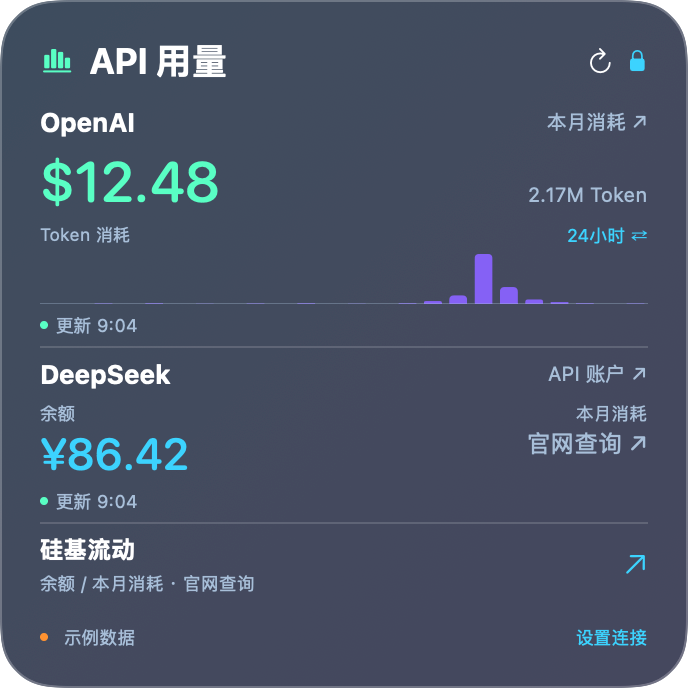

# API 用量卡片

独立的原生 macOS API 监测工具，沿用现有深蓝紫毛玻璃桌面卡片。仅监测 API，不读取 ChatGPT/Codex 订阅或本机会话。

## 数据范围
- OpenAI：组织 Admin Key 查询本月费用及Responses / Chat Completions 输入/输出 Token、请求数（UTC 月份）；费用与用量独立刷新。无公开余额接口，不把预算当余额。
- DeepSeek：普通 API Key 查询账户余额、充值余额和赠送余额；按币种分别显示。历史调用用量未接入。
- 硅基流动国内站：旧余额接口下线，显示明确状态与官方控制台入口，不采集浏览器登录信息、不向失效端点发送密钥。

## 目录与交付
Sources/Core.swift 为接口和模型，Store.swift 为钥匙串/缓存/刷新，Views.swift 为卡片和设置，App.swift 为菜单栏及桌面窗口。Assets 为原创代码绘制图标。
`python3 build.py` 构建 Apple Silicon macOS 14+ 应用和 ZIP。`python3 test.py` 运行隔离接口测试。`交付/API用量卡片.app` 可直接打开。软件内填写密钥；默认每 5 分钟刷新，可选择 1/5/15/30 分钟。没有系统维护定时任务。

## 注意要点
只调用只读统计 GET，不发送付费模型请求。密钥只存本应用钥匙串，不写配置、缓存、日志、源码和安装包。仅允许官方 HTTPS 主机且拒绝重定向；只读取用户在本应用保存的凭据。不自动发现其他软件密钥。缓存失败时保留成功数据并标注时间。月份切换不沿用上月数据。不同币种不相加，缓存 Token 不重复计算。
设置窗口支持保存密钥/删除连接、卡片尺寸与锁定、透明度、菜单栏指标、登录启动。默认不启用登录启动。没有 WidgetKit 扩展；桌面卡片不受系统小组件刷新调度限制。

## 参考
参考 CodexBar 的数据分层、OpenUsage 的余额能力边界；未复制第三方实现。
- https://github.com/steipete/CodexBar/blob/main/docs/openai.md
- https://github.com/janekbaraniewski/openusage
- https://developers.openai.com/api/reference/resources/admin/subresources/organization/subresources/usage/methods/costs
- https://developers.openai.com/api/reference/resources/admin/subresources/organization/subresources/usage/methods/completions
- https://api-docs.deepseek.com/api/get-user-balance/
- https://docs.siliconflow.cn/docs/release-notes/overview

## 1.0.0 交付状态（2026-10-30）
- 已生成 Apple Silicon / macOS 14+ 应用和 ZIP；本机启动、设置窗口和中/大号切换已验证。
- 23 项隔离接口检查通过：UTC 月份、分页、币种隔离、精确金额求和、缓存 Token 不重复计数、权限/限流/重定向错误、缺字段拒绝、主机及 TLS 限制、缓存往返等。
- 三档示例图已渲染检查，金额仅为示例；首次真实运行显示待连接。
- 最终 ZIP 解压后通过完整签名检查。桌面云同步会添加扩展属性，构建脚本已在复制后清除并验证。
- 未配置真实账号，真实 API 数据、钥匙串实际授权、登录启动、桌面拖动手感和跨屏浮窗位置未做账号/人工验证。
- 本轮未安装到系统应用程序目录，未发布 GitHub，也未启用登录启动。可将应用拖入「应用程序」后开启登录启动。
- 左键点击菜单栏打开卡片，右键打开设置菜单。解锁后拖动卡片左上标题移动；刷新/锁定按钮保持可点击。
- 当前不是三家全功能接入：OpenAI 余额、DeepSeek 历史用量、硅基流动国内自动查询未提供。

## 1.1.0 · 趋势、官网入口与工具箱

- 本月费用与余额分别展示。OpenAI 使用官方 Costs API 日费用；柱状图为 Responses / Chat Completions 的 Token 消耗，不是小时费用。输入包含缓存，不重复累加。
- 点击 24小时 / 7天切换柱状图；前者按小时（含当前不完整小时），后者按 UTC 日（含今天），跨月也保持完整时间范围。切换只读取缓存，不重复请求。缺失统计不伪造为零。
- 点击 OpenAI 金额进入官方用量页；点击 DeepSeek 数据进入官方用量页；硅基流动进入国内控制台。链接不包含密钥，登录由用户完成。
- DeepSeek 本月费用与硅基流动余额/月费用暂没有可用官方接口，仅显示「官网查询」，不使用余额差额估算。OpenAI 余额仍不支持。
- 桌面工具箱 1.0.3 已加入本应用。支持 164×164、344×164、344×344、位置/显隐、毛玻璃、明暗、透明度、吸附和排列回执。仅分享布局元数据，不分享密钥或费用。
- 本地测试：31 项接口测试、11 项隔离桥接测试；工具箱 262 项布局、20 项选择/草稿测试通过。界面示例不代表实际账号用量。
- 应用与工具箱目前手动更新。没有宣称支持 WidgetKit 或三家完整自动账单查询。

最终验证：本机已显示 OpenAI 本月费用/小时 Token 数据及 DeepSeek 余额；未把账号数据纳入源码或截图。柱状图底部加入细横线。工具箱入口与实际布局回执已核验，未代用户执行整桌排列。

